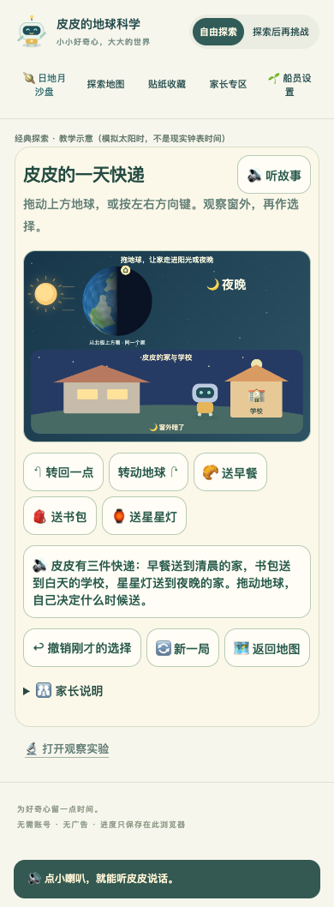
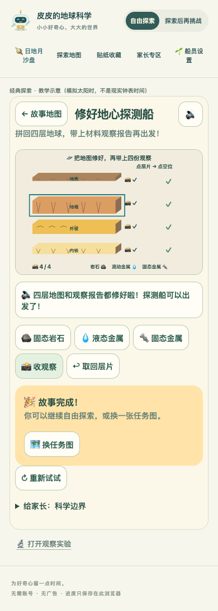
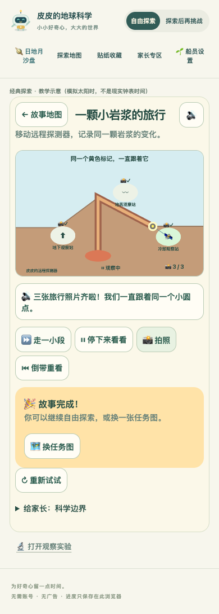
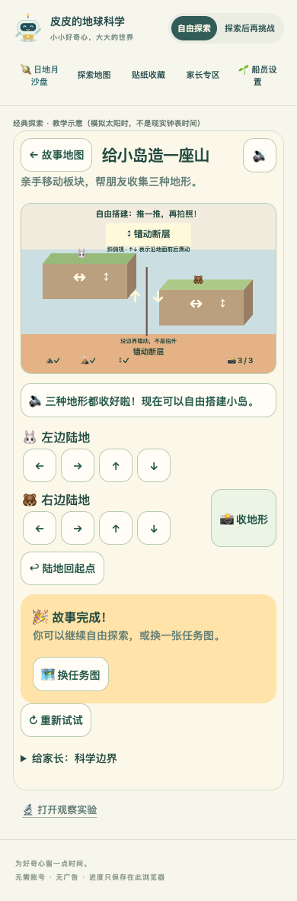

# 皮皮的地球科学大冒险 · 八关故事版评审

版本：`20261106-stories-84026fa71e10`  
测试与发布验证：**56 项单元测试、本地及线上实际资源各 46 项浏览器测试全部通过；323 个公网资源哈希一致。线上浏览器通过校验证书和哈希的本地传输访问真实资源，不等同于实体手机验收**

[打开八关故事地图](https://dh871145087-ui.github.io/pipi-earth-review/classic.html) · [完整日地月沙盘](https://dh871145087-ui.github.io/pipi-earth-review/) · [静态评审网页](https://dh871145087-ui.github.io/pipi-earth-review/review.html) · [下载完整发布副本 ZIP](https://github.com/dh871145087-ui/pipi-earth-review/archive/refs/heads/main.zip) · [RELEASE.json 校验清单](https://dh871145087-ui.github.io/pipi-earth-review/RELEASE.json)

## 本次差异与评审范围

用户反馈“仍然无聊”后，已确认让其余七关全部故事化。此次新增昼夜、世界时间、公转、四季、地心、火山、板块七个故事；保留此前完成的影子送冰淇淋冒险。**不是只换标题：孩子需要选择投递时机、移动路线、衣物、层片、观察位置或板块方向，成功条件来自这些操作形成的状态。**

原观察实验入口仍保留；日地月沙盘继续可用。上一版的完整说明仅作[固定旧基线](https://github.com/dh871145087-ui/pipi-earth-review/blob/5a037cb367a48305c07862d496bdacc775d1eecd/REVIEW.md)引用，不在本页重复累积。请 Pro 重点试玩本轮七项新增，同时回归影子冒险的入口和共用档案。

本页是静态材料，无需 JavaScript；完整游戏需要浏览器执行 JavaScript。ZIP 对应当前 main，请核对 RELEASE.json；下载后通过本地 HTTP 服务运行。若只看文字、截图或代码，请明确没有实际试玩，不把静态材料称为交互验收。

## 八关里，孩子具体决定什么

| 入口 | 本次状态 | 孩子的操作与结果 |
| --- | --- | --- |
| [皮皮的一天快递](https://dh871145087-ui.github.io/pipi-earth-review/classic.html?adventure=day) | 新增 | 转动地球，选择清晨送早餐、白天送书包、夜晚送星星灯。送错时间物品留在车上，生活场景与同一地点的光照对应。 |
| [跨洋生日连线](https://dh871145087-ui.github.io/pipi-earth-review/classic.html?adventure=world) | 新增 | 并排观察两个朋友的窗景。朋友睡觉时寄留言，再找到两边都亮着的时机打生日电话；转动一次地球同时改变两个地方。 |
| [皮皮的清凉快递](https://dh871145087-ui.github.io/pipi-earth-review/classic.html?adventure=ice) | 保留（影子） | 点地面推车，捡水果，选择路线与有限放伞位置，再送到朋友家。阳光下融化快、树荫里慢，冰淇淋与奶昔都能送达；停下思考时暂停。 |
| [生日太空列车](https://dh871145087-ui.github.io/pipi-earth-review/classic.html?adventure=orbit) | 新增 | 沿轨道拖动列车或按方向箭头，到半圈站拿包裹，再绕回起点小旗庆祝。直接跳位置或只在起点点庆祝不能完成。 |
| [南北旅行箱](https://dh871145087-ui.github.io/pipi-earth-review/classic.html?adventure=seasons) | 新增 | 同时看南北朋友的故事天气与白昼条，给两地选帽子或外套，半年后再比较。可换月份、改变地轴倾角观察，衣服选择可撤销。 |
| [修好地心探测船](https://dh871145087-ui.github.io/pipi-earth-review/classic.html?adventure=inside) | 新增 | 点选或拖动不同厚度的彩色层片，拼回斜切地球剖面；再匹配材料状态、分别拍下四层观察。错槽或错材料不算完成，可取回重试。 |
| [一颗小岩浆的旅行](https://dh871145087-ui.github.io/pipi-earth-review/classic.html?adventure=volcano) | 新增 | 移动远程探测器，在连续的上升、地表流动、冷却过程中追踪同一个标记。拍照必须同时处于合适站点与时机；可暂停、倒带重看。 |
| [给小岛造一座山](https://dh871145087-ui.github.io/pipi-earth-review/classic.html?adventure=plates) | 新增 | 拖动两块陆地，或分别用方向按钮移动，实际相对位移决定山脉、海脊或错动地形。先看图形任务卡再自己决定方向，收集三种地形。 |

每关有 **3 种初始变体**。重玩可以改变出发时刻、城市组合、起点、旅行月份、层片顺序、探测器位置或地形任务顺序；这不等于每关新增三个独立大章节。完成后可以继续自由操作，再换任务图；错误选择有可恢复反馈，不要求一次答对。

## 两个孩子与语音

两位船员分别保存冒险完成记录，并继续共用沙盘与经典区的身份、阅读、声音和减少动态偏好。**冒险记录与科学贴纸分开**：送到点心、修好地图或完成故事，仅表示操作目标完成，不证明已理解科学原因，也不自动当作科学理解贴纸。

本轮新增 **69 条固定本地配音**，影子原有 21 条本地配音保留。听着玩有短提示；自主阅读偏好下仍可主动点读。语音可用性与实际扬声器听感分别验收。手机图形操作和短句是主要入口，家长仍可展开科学边界说明。

## 当前截图

[昼夜原图](https://dh871145087-ui.github.io/pipi-earth-review/review-images/stories-day.png)

[地心原图](https://dh871145087-ui.github.io/pipi-earth-review/review-images/stories-inside.png)

[火山原图](https://dh871145087-ui.github.io/pipi-earth-review/review-images/stories-volcano.png)

[板块原图](https://dh871145087-ui.github.io/pipi-earth-review/review-images/stories-plates.png)

截图用于检查布局和可读性，不能替代操作体验。

## 必须保留的科学边界

- 昼夜和世界时间使用教学太阳时与光照示意，不是现实民用作息表；转地球改变时刻，投递或角色动作不替代地球运动。
- 公转列车是轨道旅行比喻，起点和半圈标记用于比较；不把按固定次数按钮当成一年概念理解。
- 四季的衣服来自故事天气提示，不把实际天气简单等同于月份或白昼长短；换衣本身不证明理解四季。倾角和南北白昼比较仍需独立观察。
- 地心层片为可操作而夸大厚度，不按真实比例。地幔主要是固态岩石，能非常缓慢地变形；外核是液态金属，内核主要为固态金属。
- 火山追踪的是同一份物质：地下叫岩浆，到地表叫熔岩，冷却后逐渐凝固。过程加速；远程探测器是虚构教学装置，不引导孩子靠近真实火山。减少动态模式用显式步进，仍须选站与抓时机，拍照不会自动成功。
- 板块使用加速的斜俯视剖面，屏幕上下箭头表示沿地面前后错动，不是垂直抬升。真实造山、裂谷和海脊演化漫长，不能把所有碰撞或分离视为同一过程。
- 影子只减慢融化，不会神奇冷冻；补满发生在起点冰柜。融化速度是游戏示意，不是食品保存模型。

## 请 Pro 实际玩，再回答

1. **是否真的需要选择？** 每关至少尝试一次不合适操作，再完成正确路径。程序是否替孩子做了核心决定？有没有可以无视条件连续点就过的路径？
2. **能否看见因果？** 操作改变了什么，观察结果是否同屏、具体且一致？请特别看昼夜光照、火山同一标记和板块相对运动。
3. **能否不依赖识字自己玩？** 390 像素宽度下，图形目标是否容易点中，点读能否解释下一步，提示是否抢话或遮挡？
4. **是否愿意再试？** 初始条件改变以后，孩子是否仍有事情可发现？完成反馈和自由探索有没有理由让人多玩一次？
5. **是否可靠？** 切换孩子后冒险记录是否隔离；返回观察实验与日地月是否保持同一身份；重玩是否保留已保存成果？
6. 请把发现分成可复现缺陷、对趣味性的评审判断、需要孩子试玩验证的假设，并写清版本、关卡、操作步骤和实际结果。

**真实孩子的趣味性、自主操作和学习效果尚未验收；真实扬声器听感尚未验收。** 自动化通过只能支持所覆盖的逻辑与操作链，不能证明孩子喜欢玩。家庭试玩分别记录：哪里需要家长代读/代点、换起始条件后能否再做、故事完成后是否愿意主动继续。

本轮不新增日地月任务，不加入月亮连续回放，也不扩大到更多模块。先验证八个现有模块是否从“可操作教材”变成有目标、有选择、可反复探索的故事。
