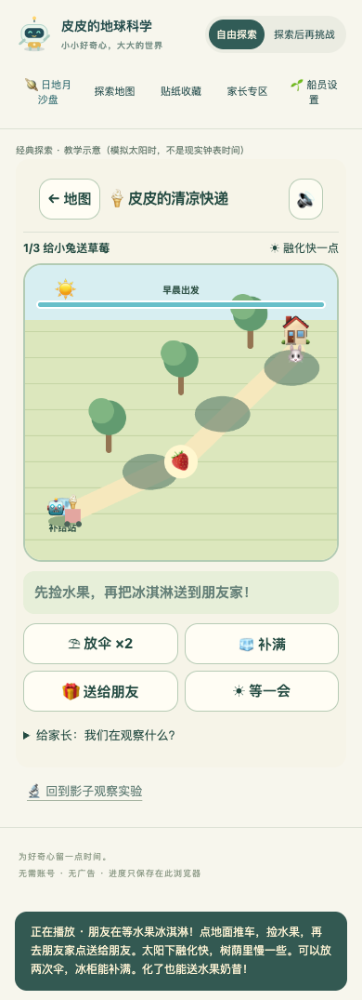
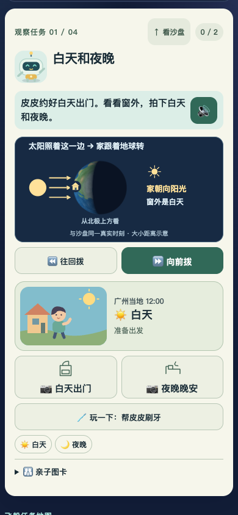
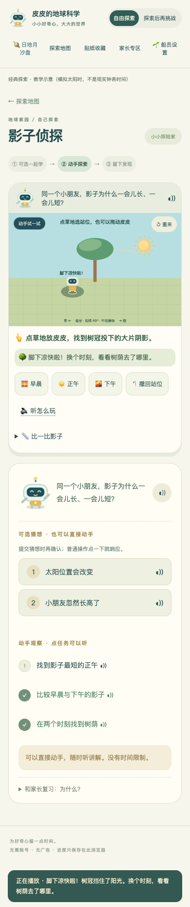

# 皮皮的地球科学大冒险 · 送冰淇淋冒险评审

本次版本：`20261106-adventure-a9ef397f070b`。验证结果：**46 项单元测试、本地及线上资源各 36 项浏览器测试通过；254 个公网资源哈希一致。线上交互使用校验证书和哈希的本地传输，非实体手机验收**。

[直接玩送冰淇淋冒险](https://dh871145087-ui.github.io/pipi-earth-review/classic.html?adventure=ice) · [完整游戏](https://dh871145087-ui.github.io/pipi-earth-review/) · [下载当前完整副本 ZIP](https://github.com/dh871145087-ui/pipi-earth-review/archive/refs/heads/main.zip) · [静态评审网页](https://dh871145087-ui.github.io/pipi-earth-review/review.html) · [发布校验清单](https://dh871145087-ui.github.io/pipi-earth-review/RELEASE.json)

## 本次只聚焦：孩子愿不愿意自己送一趟？

用户认为上一版仍然无聊，因此本次让影子关先成为一个具体故事：**皮皮推着冰淇淋车，捡水果，给朋友送点心**。故事冒险作为主入口，原影子观察实验仍可进入；没有把其余关卡同时改成冒险。

请 Pro 实际运行这次新增玩法，复核趣味性、操作清晰度和选择是否有意义。下方原四项说明留作上一基线，无需从头重复评审。若只能看文字或截图，请明确未实际试玩；不能据此判断孩子一定爱玩。

### 玩法与边界

- **三张地图、不同出发时刻**：给小兔送草莓、参加小熊野餐、去小猫花园；起点、配料和目的地不同。点地面推车，先捡水果，再到朋友家送达。
- **选择路线与遮阳位置**：树荫随教学太阳时移动；每局有两次放置或移动遮阳伞的机会，可取消放置模式。伞杆的位置不等于地面影子中心。
- **阳光下融化快、树荫中慢一些**：树荫和伞不会把已经融化的冰淇淋重新冻住。回到起点冰柜可重新补满，不会因为融化进入死局。
- **两种送达结果都接受**：保持凉爽可以送水果冰淇淋，融化后也能和朋友分享水果奶昔，不以“必须完美保冰”作为通关条件。
- **停下思考时暂停**：只有行走或主动选择“等一会”才推进教学时间与融化。减少动态模式仍按沿路经过的阴影计算，不靠瞬移免除融化。
- **完成后自由玩**：可以继续探索、同地图再送一次，或者换下一张地图。送达记录是故事成果，暂不判为科学理解贴纸。
- **21 条本地配音**：支持短故事提示与点读；显式点读在自主阅读偏好下也可使用。配音资源可用不等于已验收真实设备扬声器听感。

这是春秋分、北纬 40°、平地条件的教学模型；树冠和伞简化为水平遮光面。时间和融化速度经过游戏化加速，不是实际食品保存模型。

[查看手机截图原图](https://dh871145087-ui.github.io/pipi-earth-review/review-images/adventure-phone.png)。截图用于检查布局，不能替代真实交互体验。

### 请 Pro 实玩后回答

1. 不先读说明，能否看懂“捡水果—送朋友”的目标，知道点哪里移动、何时送达？
2. 路线、树荫和两次放伞是否带来有意义的选择，还是仍然一路随便点就结束？请指出具体地图和操作。
3. 奶昔结果是否让孩子愿意探索，同时仍看得见“树荫减慢融化”的区别？不要把送达当作理解证据。
4. 完成后是否有理由主动再试一条路或换地图？哪些地方像冒险，哪些仍像操作教材？
5. 在 390 像素宽度下，目标、推车、阴影、按钮和反馈是否清楚好点？语音是否打断探索？

**真实孩子试玩尚未验收，真实扬声器听感也未验收。** 自动化检查可以验证状态与操作链，不能证明趣味性。请把可复现缺陷、对趣味性的评审判断和需要孩子实测的假设分开。

---

## 上一基线：四项改进与跨页档案保护

上一基线版本：`20261106-discovery-5b02e46c3616`。上轮 Pro 实际试玩基线：`20261106-engagement-0b72a80ccd9d`。

本轮只落实已确认的四项：**统一儿童档案、手机因果同屏、影子关自主站位、减少普通操作确认**。请重点复核这些新增差异和上轮问题，不必重做整套项目背景评审。

[打开完整游戏](https://dh871145087-ui.github.io/pipi-earth-review/) · [打开经典八关](https://dh871145087-ui.github.io/pipi-earth-review/classic.html) · [静态评审网页](https://dh871145087-ui.github.io/pipi-earth-review/review.html) · [下载完整发布副本 ZIP](https://github.com/dh871145087-ui/pipi-earth-review/archive/refs/heads/main.zip)

ZIP 是当前 main 分支的完整静态副本，下载后请核对版本；游戏需通过本地 HTTP 服务运行。本文和静态评审网页无需执行 JavaScript。若无法运行游戏，请明确只审阅了文字或截图，不把它们称为实际试玩。

[查看发布校验清单 RELEASE.json](https://dh871145087-ui.github.io/pipi-earth-review/RELEASE.json)：用于核对版本和 233 个游戏资源的 SHA-256，不含个人服务器路径。

## 四项改动及复核重点

| 上轮问题 | 本轮实现 | 请重点验证 |
| --- | --- | --- |
| 手机任务看见生活结果时，上方三维模型已离屏 | 任务内加入简化科学小窗，与结果、当前操作一起显示；小窗与主沙盘读取同一个模拟快照 | 390 像素宽开始观察后，能否同时指出“什么动了、哪里变暗了”，小窗是否清晰而非缩小控制台 |
| 新沙盘按船员，经典关按年龄，身份和进度分裂 | 两位船员共用身份、阅读、声音、探索方式和各自进度；经典首页可返回沙盘 | 新→经典→新保持同一孩子；改变阅读支持不改变科学挑战；切换孩子不串进度 |
| “走进树荫”按钮直接替孩子完成选择 | 点击地面、拖动皮皮或用方向键自主站位；上午与下午阴影改变，人物不会自动跟随 | 阳光下不会成功；先找一次树荫，改时间后重新寻找；撤回不生成新观察 |
| 换装、拼图等普通操作每次都弹确认 | 换装和试放层片直接响应，可再选、清除或撤回；名称另有点读；猜想保留确认 | 未识字孩子能否靠图形试操作；普通动作是否无弹窗；取消猜想是否未提交 |

阅读支持和科学挑战分开：一个孩子可听着完成较深的探究，另一个也可阅读着自由探索。首次导学可跳过，回访直接进入游戏，讲解仍可随时重播。

### 科学小窗具体保留什么

- 昼夜：太阳照射方向、地球、同一个“家”标记，以及家朝光或背光与窗外昼夜的对应。
- 月相：月亮相对地球的位置、照亮的一面、同一时刻从地球看到的月盘。
- 白天找月亮：天空、地平线及太阳和月亮在其上方或下方的位置。角度数值在详情层查看。
- 月球兔子：地球、同一个月面标记、运动方向和固定空间方向参照。

小窗是同一科学状态的示意投影，不是第二套独立计时器，也不是按真实比例绘制的距离图。本轮没有新增“两次记录之间连续回放”的任务能力。

## 本轮手机实际截图

昼夜任务：请检查孩子拨时间时能否同时观察原因与结果。[打开原图](https://dh871145087-ui.github.io/pipi-earth-review/review-images/discovery-day-phone.png)

影子关：请检查地面是否容易点中、反馈是否清楚，人物和阴影是否便于区分。[打开原图](https://dh871145087-ui.github.io/pipi-earth-review/review-images/discovery-shadow-phone.png)

## 档案迁移与跨页保护

经典八关现在按两位船员分别记录进度，不再用 little/big 作为孩子身份。旧记录无法判断属于谁，因此只显示为“未分配的旧记录”，不会随意归给任何一个孩子。

- 原 `pipi-earth-v1` 不改写，首次迁移原值另存 `pipi-earth-v1-backup`。
- 旧版沙盘迁移到共用档案前，原值保留在 `pipi-universe-v1-backup-before-profiles-v2`，首次备份不覆盖。
- 每次修改先读最新持久档案，合并本次变更；不同页面记录不同任务时，已保存记录不被旧页面整体覆盖。
- 另一页切换身份或修改档案后，当前页会停止声音和动画并重新载入，清掉临时任务；旧界面的动作不能写给新孩子。已保存进度保留，未保存的本轮临时操作会重置。
- 对浏览器返回缓存恢复也做状态检查。公开评审站与个人服务器是不同来源，浏览器存档分别保存，不是云端同步。

建议在同一站点打开“沙盘”和“经典”两个标签页：切换船员，确认另一页更新；分别留下任务记录，再回来看两份记录是否保留；切换另一孩子后检查其记录仍独立。不要仅以两个下拉框显示一致来判定通过。

## 影子玩法的科学边界

这是固定纬度、春秋分、平地条件的教学模型。树冠投影用可交互的简化形状表示，不能当成任意真实树木的精确阴影。测量杆与树冠高度不同，长度记录和站位任务分别对应各自对象。

选择站位后，光照反馈说明“这里还有点晒”或“脚下凉快啦”，不替孩子自动纠正。改变时间后，树荫移动，皮皮留在原地。不同时间的自主寻找才产生不同观察；撤回不增加观察次数。经典关的“教学示意”与新沙盘的日期时间标识分开，未把全部八关改成精密天文模型。

## 测试与验收边界

本地自动化：**42 项单元测试 + 32 项端到端测试通过，零跳过**。覆盖档案迁移、两人隔离、双页真实 UI 同步与记录保留、普通操作撤销、回访、影子点击/拖动/键盘和手机宽度等。

线上资源验证：233 个文件（7,332,193 字节）通过公网证书校验与逐文件 SHA-256 比对。将实际线上资源交由本地 4175 端口承接后，完整 32 项端到端测试全过，零跳过、零 flaky；个人服务器配置和容器状态未变。此验证覆盖发布资源及其交互，不是直接 IP 网站的真机验收。

浏览器返回缓存的恢复事件有自动化覆盖，但不等于验证了所有浏览器的真实 BFCache 命中。390 像素浏览器视口测试也不等于真实手机触摸验收。

**两个孩子的实际试玩、真实扬声器听感和长期学习效果尚未验收。** 通关与贴纸不证明理解。家庭试玩应分别记录：家长何处必须代读/代点；换起始条件后孩子能否再做；拿到贴纸后是否愿意主动再试。

## 请 Pro 仅重点复核

1. 手机同屏是否真的连起原因与结果，而不是多了一张孩子忽略的小图？
2. 档案、阅读支持、科学挑战和跨页重载规则是否一致、清楚；是否有丢失或错误归属记录的路径？
3. 影子关是否由孩子判断站位，误放反馈和重新寻找是否有趣，触控目标是否容易操作？
4. 普通操作是否足够直接；点读与猜想确认是否仍有不必要门槛？
5. 哪些是可复现缺陷，哪些只是需要两个孩子试玩验证的假设？请区分发布阻断与后续建议。

本批保留原有四个日地月任务和经典八关。**月亮连续回放、地心层片玩法重做、火山标记追踪不在本批改造范围**；地心仅调整普通拼图操作的确认和撤销，不宣称已实现新的立体层片玩法。请先判断这四项是否解决上轮重点，再决定后续工作。
