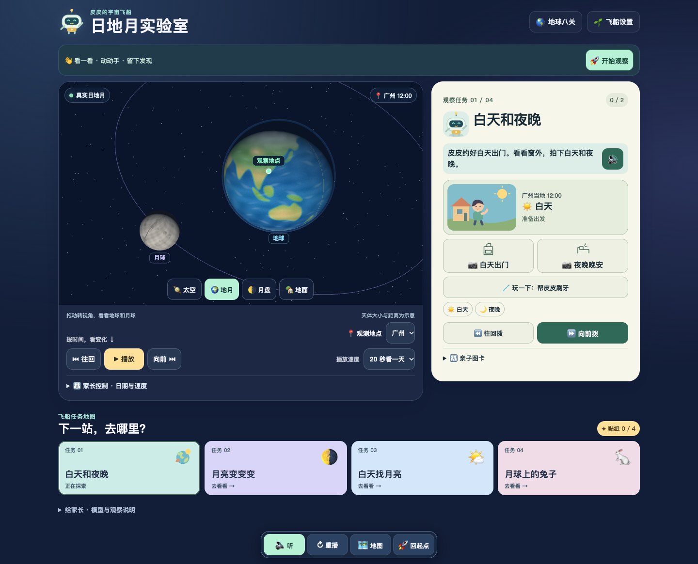
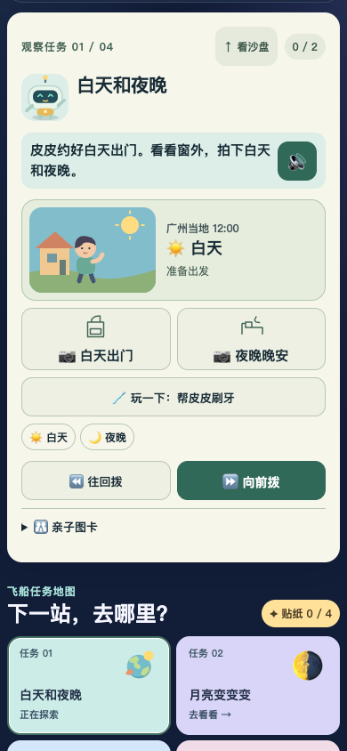
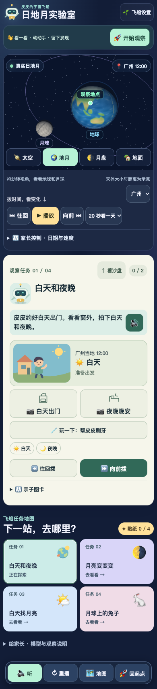
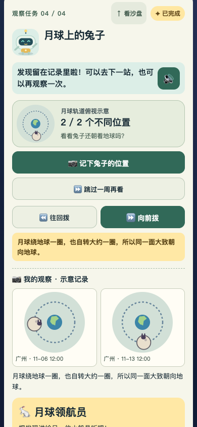

# 皮皮的地球科学大冒险：给 ChatGPT Pro 的评审页面

本页无需登录，无需执行 JavaScript，包含实际截图、玩法、科学边界和测试证据摘要。请基于可见材料评审；如果无法运行三维游戏，请明确没有亲自验证交互，不把截图阅读称为试玩。

[打开完整三维游戏](https://dh871145087-ui.github.io/pipi-earth-review/) · [查看图文网页](https://dh871145087-ui.github.io/pipi-earth-review/review.html)

固定评审版本：`20261106-engagement-0b72a80ccd9d`。230 个游戏文件与个人服务器正式构建一致。此副本不会自动跟随未来正式版更新。新域名不会自动继承旧域名的浏览器存档。

## 目标与受众

同一个家庭的两个孩子：一个能自主阅读，一个尚未识字。希望他们能与家长共同学习，也能独立探索。重点是趣味性、具体三维场景、生活情境和科学原理，避免抽象文字题与“点按钮领奖”。不把识字能力等同于理解能力。

## 当前实际界面

### 桌面地月视角

左边是真实 UTC 驱动的三维沙盘，右边是当前任务，下面是四站地图。地月、太空、月盘和地面视角读取同一时刻。

### 手机开始观察后

390 × 844 视口。点击首屏“开始观察”后，短步骤、人物、白天/夜晚记录按钮与任务旁时间控制可见，工具栏不覆盖操作。

### 手机完整页面

### 月球兔子的前后对比

最后一张来自独立测试过程，截图拍摄于日期标签补全年份之前；最终版使用观察地的完整年月日和时间。所有对比小图均为天文模型重建的示意记录，不是真实相机照片。

## 孩子的完整操作流程

1. 点首屏“开始观察”，直接来到当前任务。
2. 未识字模式显示短步骤和喇叭，自动反馈使用本地中文语音；自主阅读模式显示完整说明，不强制朗读选项或答题结果，仍可主动点击喇叭。
3. 拨动时间，看地点光照与天体位置变化。切换相机和生活动作不改变时间。
4. 记录观察或匹配月形，留下 UTC、城市和观察动作。完成时播放具体科学解释，再展示贴纸。
5. “下一站”继续探索；“再观察一次”清空本轮进度，保留永久贴纸和上一轮记录。再次完成不会重复增加贴纸。

亲子图卡支持“先听选项，再确认选择”，取消试听不算作答。答题不决定观察奖励。两个船员分别保存阅读偏好、设置、观察和贴纸。

## 四个已实现的任务

### 1. 白天和夜晚

故事：“皮皮约好白天出门，看看窗外。”孩子观察小屋，拍下同一城市的白天和夜晚，前后两张图比较。背书包、刷牙、说晚安具有不同动作。任务旁按钮每次前后拨一小时。

原理：地球自转，让同一地点轮流朝向和背向太阳。刷牙、上学、睡觉是生活动作，不能当作普遍的天文学正确答案；白天休息不会被解释成科学错误。

同轮不允许用广州的白天和伦敦的夜晚拼成“同一地点的变化”。完成后可以保持同一 UTC 换城市，继续比较“此时另一座城市也天黑了吗”。

### 2. 月亮变变变

先看月盘，再从细月、半月和满月图中匹配，收集三种形状。可选观察站只使用编号；跳转本身不奖励，记录前不显示月形名称与亮度百分比答案。

原理：月亮反射太阳光，日地月位置变化，使地面观察者看到的亮面比例变化。不是月球本体变瘦，也不是普通月相由地影遮挡。

### 3. 白天找月亮

从地面全景寻找太阳与月亮同时位于地平线上方的时刻。可选“带我看一次”会寻找后续观测时刻，孩子仍需记录。帮助不会直接发贴纸。

游戏取样条件是太阳与月亮中心均高于地平线 5°；这不保证真实天空一定肉眼可见。真实可见性还受天气、天空亮度、月相及与太阳的角距离等影响。

### 4. 月球上的兔子

兔子是画在月面上的方向标记。孩子先猜朝向，再记录两个不同轨道位置；位置间隔至少 70°。两张图并排显示，方便看出兔子仍大致朝地球。

原理：月球公转一圈，也自转约一圈，所以大致同一面朝向地球，不能由此推断它没有自转。当前任务仍依靠孩子观察对比，尚未通过真实儿童复述或玩具演示验证学习效果。

## 技术与科学边界

- Astronomy Engine 2.1.19 统一计算真实 UTC 快照，Three.js 0.187.0 渲染。
- 天体大小和距离采用教学显示比例，不能从屏幕距离推断实际比例。
- 月面、兔子标记、参考轨道为示意；同步自转近似未含真实天平动。
- 地面图为有方位标记的 360° 天空全景示意，不是无畸变的透视相机。
- 不模拟天气、遮挡、大气折射及食相。观察真实天空时不要直视太阳。
- 原经典八关保留教学简化模型，尚未全部迁移到统一真实 UTC 模型；本轮不是十专题全部交付。
- 两个船员数据只保存在本机浏览器，不采集儿童姓名或实时定位。

## 已验证与未验证

- 科学、坐标、任务规则和存档单元测试：34 项通过。
- 本地正式构建及个人服务器线上资源：分别 19/19 浏览器测试通过，零跳过。
- 230 个正式游戏资源 SHA-256 校验一致。
- 浏览器覆盖四个新任务、原八关、船员隔离、帮助不领奖、先听后确认、重玩、当地日期跨日、同城保护、同 UTC 换城、WebGL 降级和音频解码/拒播。
- 截图覆盖 390、834、1440 像素宽度；新增手机主行动与按钮无遮挡验收。
- 原服务器线上交互测试用逐请求验证证书和哈希的本机传输，不冒充原 IP 域的实体手机验收。
- 实体 Safari、扬声器真实听感、低端设备性能、两个孩子独立完成与主动重玩仍未验收。

## 请 Pro 优先评审

1. 未识字孩子是否知道下一步、听懂反馈？哪些地方仍依赖家长读字？
2. 哪些操作真正带来可观察的发现，哪些仍容易退化为按提示配对领奖？
3. 生活作息、月相、同步自转与白日可见性的表达是否会造成误解？
4. 现有奖励、记录与换角色玩法能否让孩子主动重玩？请区分设计判断和实测结论。
5. 只给最值得实施的 3–5 项改进，说明具体触发场景、改法及儿童试玩验收方式。保留已认可的画风与统一科学模型，避免无必要重写架构或扩充关卡。
